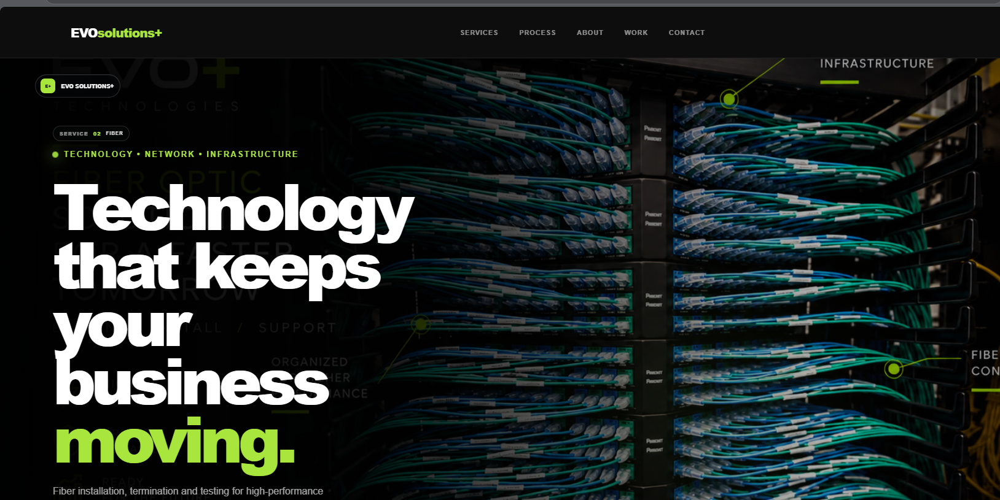

# EVO Solutions+

### Technology · Networks · Infrastructure

**Technology that moves your business forward.**

EVO Solutions+ provides professional technology infrastructure solutions for businesses in Austin, Round Rock, and surrounding areas in Texas.

We help businesses build, organize, install, and modernize their technology infrastructure through reliable, scalable, and professionally executed solutions.

🌐 **Official Website:** https://evosolutionsjv.com

---

## Our Services

- Network Infrastructure & Structured Cabling
- IDF / MDF Installation & Organization
- Fiber Optics Installation & Testing
- Wi-Fi & Wireless Infrastructure
- CCTV & Security Camera Infrastructure
- IT Infrastructure Support
- Audio / Video Infrastructure
- Voice & Phone Systems
- Low-Voltage Technology Solutions

## Website Features

The EVO Solutions+ website was designed to deliver a modern, responsive, and interactive digital experience.

- Responsive desktop, tablet, and mobile layouts
- Interactive technology service showcase
- Animated service navigation
- Dedicated service information pages
- Project portfolio and installation gallery
- Interactive project contact builder
- WhatsApp and Instagram integration
- Search engine optimization fundamentals
- Performance-focused user interface

## Technology Stack

The local website project uses:

- React
- TypeScript
- Vite
- CSS
- Motion animations

**Production Website:** Published and managed through Framer.

> The local source code and the production implementation in Framer may differ. This repository documents the local development project and its design direction.

## Website Structure

The published website includes:

| Page | Description |
|---|---|
| Home | Interactive introduction to EVO Solutions+ |
| Services | Technology infrastructure solutions |
| Process | Planning, installation, connection and support |
| About | Company philosophy and values |
| Work | Selected installations and projects |
| Contact | Interactive project inquiry experience |

## Local Development

Install dependencies:

```bash
npm install
```

Start the development server:

```bash
npm run dev
```

Build for production:

```bash
npm run build
```

## Brand Identity

**Official Brand:** EVO Solutions+

**Visual Abbreviations:** EVO+ / E+

**Primary Colors:**

- Black: `#0D0D0D`
- Dark Gray: `#1A1A1A`
- Lime Green: `#A8E63E`
- White: `#FFFFFF`

The visual identity emphasizes precision, connectivity, reliability, and modern technology infrastructure.

## Contact

**EVO Solutions+**

Austin · Round Rock, Texas

- Website: https://evosolutionsjv.com
- Email: info@evosolutionsjv.com
- Phone: +1 (512) 966-7004
- Instagram: https://instagram.com/evosolutionsjv

---

© 2026 EVO Solutions+. All rights reserved.
